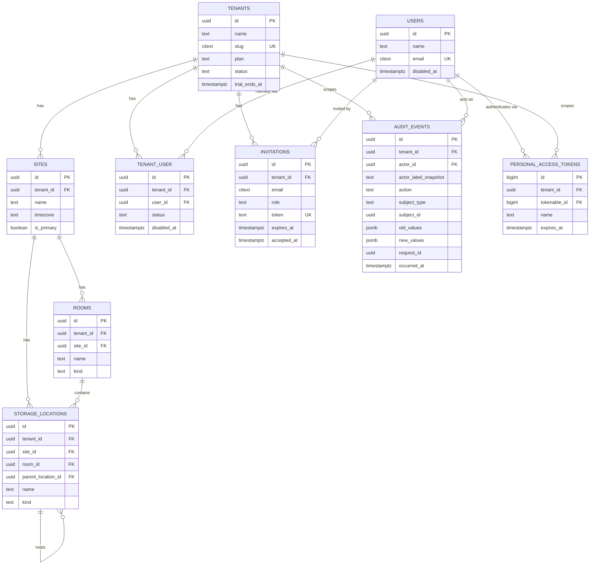

# ERD — S0-ANA-02: PostgreSQL Multi-Tenant Model

Status: **draft, awaiting approval**. No migrations exist yet for anything in this
document. Scope is the S0 backlog item: tenants, sites, rooms, locations, users,
membership, roles, invitations, and the audit log — the substrate every later
sprint (S1–S6) builds on. Tables from S2+ (catalogue, inventory, cycles, labels,
traceability) are listed at the bottom for orientation only, not designed yet.

---

## 1. Design decisions this ERD makes (confirm before migrations)

1. **Primary keys are UUIDv7 everywhere**, per `CLAUDE.md`. PostgreSQL 18 ships a
   native `uuidv7()` function; we use it as the column `DEFAULT` (so raw SQL,
   seeders, and console inserts always get a valid time-ordered UUID) **and**
   generate the value in the model's `creating()` hook via `Str::uuid7()` (so
   Eloquent has the id available immediately after `save()`, before any DB
   round-trip). Belt and suspenders, same pattern the invariants section asks
   for everywhere else.
2. **`users` is a global identity table, not tenant-owned.** One email = one
   login for the whole platform. Per-tenant membership, status, and role are
   external to it (`tenant_user`, spatie `model_has_roles`). This matches the
   domain model's explicit `tenant_user` pivot in the build brief.
   `users` therefore does **not** get RLS keyed on `tenant_id` (it has no such
   column) — see §4 for how we still prevent cross-tenant user enumeration.
3. **A Sanctum token is scoped to exactly one tenant.** Even though a user can
   (at the data-model level) belong to more than one practice via `tenant_user`,
   authentication — web session or mobile token — resolves to a single active
   tenant chosen at login. Switching practice means logging in again. This is
   what makes "tenant never comes from a request parameter" actually hold: the
   token/session *is* the tenant, unambiguously. See open question OQ-2.
4. **The existing starter-kit `users` table uses a bigint `id`.** Bringing it to
   UUIDv7 means a migration that swaps the primary key and updates the
   `passkeys.user_id` FK. Flagged here, not touched until this ERD is approved.
5. **RLS is enforced via `SET LOCAL app.tenant_id`** inside the transaction
   wrapping each request — not `SET` (session-level). Octane/FrankenPHP keeps
   worker processes (and their DB connections) alive across requests, so a
   session-level `SET` would leak the previous request's tenant into the next
   one on the same worker. `SET LOCAL` is transaction-scoped and always
   resets. Every request that touches tenant data must run inside a DB
   transaction opened by middleware for this reason, not just for writes.

---

## 2. Entity list — S0 scope

### `tenants`
The practice (dental clinic) — the tenancy boundary.

| Column | Type | Notes |
|---|---|---|
| id | uuid | PK, default `uuidv7()` |
| name | text | not null |
| slug | citext | unique, not null — subdomain `{slug}.steriqore.<tld>` |
| plan | text | not null, default `'trial'` — `trial`, `active`, `suspended` (billing plan tiers are out of MVP scope, kept minimal) |
| status | text | not null, default `'trialing'` — `trialing`, `active`, `suspended`, `cancelled` |
| trial_ends_at | timestamptz | nullable |
| created_at / updated_at | timestamptz | |

No `deleted_at` — a cancelled tenant is `status='cancelled'`, never deleted
(evidence must survive even a churned customer, at minimum until a documented
retention/export has happened — see `docs/data-minimization.md`, S4-ANA-01).

### `sites`
A physical location/branch of a practice. Most tenants will have exactly one.

| Column | Type | Notes |
|---|---|---|
| id | uuid | PK |
| tenant_id | uuid | FK → tenants, not null, indexed |
| name | text | not null |
| address_line1 / address_line2 | text | nullable |
| postal_code / city / country_code | text | nullable / nullable / ISO-3166 alpha-2 |
| timezone | text | not null, default `'Europe/Paris'` |
| is_primary | boolean | not null, default `false` |
| created_at / updated_at | timestamptz | |

Unique: `(tenant_id, name)`.

### `rooms`
A room within a site (sterilization room, treatment room, storage room).

| Column | Type | Notes |
|---|---|---|
| id | uuid | PK |
| tenant_id | uuid | FK → tenants, not null, indexed |
| site_id | uuid | FK → sites, not null, indexed |
| name | text | not null |
| kind | text | nullable — `sterilization`, `treatment`, `storage`, `other` |
| created_at / updated_at | timestamptz | |

Unique: `(site_id, name)`. `tenant_id` is denormalized onto `rooms` (derivable
via `sites.tenant_id`) deliberately — every tenant-owned table gets its own
`tenant_id` so RLS policies stay a single flat predicate with no join, per the
tenancy invariant. Same reasoning applies to every child table below.

### `storage_locations`
Where stock physically sits (cabinet, shelf, fridge) — the leaf inventory
location S2 will hang batches off. Self-referencing for nesting (a shelf inside
a cabinet).

| Column | Type | Notes |
|---|---|---|
| id | uuid | PK |
| tenant_id | uuid | FK → tenants, not null, indexed |
| site_id | uuid | FK → sites, not null, indexed |
| room_id | uuid | FK → rooms, nullable, indexed |
| parent_location_id | uuid | FK → storage_locations, nullable |
| name | text | not null |
| kind | text | nullable — `cabinet`, `shelf`, `fridge`, `drawer`, `other` |
| created_at / updated_at | timestamptz | |

Unique: `(site_id, name)`.

### `users`
Global identity. Already scaffolded by the starter kit (Fortify + passkeys +
2FA columns) with a bigint PK — **to be migrated to uuid** as part of this
item.

| Column | Type | Notes |
|---|---|---|
| id | uuid | PK — **migration from existing bigint id** |
| name | text | not null |
| email | citext | unique, not null |
| email_verified_at | timestamptz | nullable |
| password | text | not null, hashed |
| two_factor_secret / two_factor_recovery_codes | text | nullable (existing, Fortify) |
| two_factor_confirmed_at | timestamptz | nullable (existing) |
| remember_token | text | nullable |
| disabled_at | timestamptz | nullable — **global** kill switch (e.g. offboarded entirely), independent of per-tenant `tenant_user.disabled_at` |
| created_at / updated_at | timestamptz | |

Users are **soft-disabled, never deleted** (invariant #6) — no `deleted_at`,
only `disabled_at`, at both the global and the per-tenant level.

### `tenant_user`
Membership pivot: which tenants a user belongs to, with per-tenant status.
Role assignment itself lives in spatie/laravel-permission's teams tables
(`model_has_roles`, keyed by `team_id = tenant_id`), not here — this table is
membership lifecycle only.

| Column | Type | Notes |
|---|---|---|
| id | uuid | PK |
| tenant_id | uuid | FK → tenants, not null, indexed |
| user_id | uuid | FK → users, not null, indexed |
| status | text | not null, default `'invited'` — `invited`, `active`, `disabled` |
| invited_at | timestamptz | nullable |
| joined_at | timestamptz | nullable — set when invitation accepted |
| disabled_at | timestamptz | nullable |
| created_at / updated_at | timestamptz | |

Unique: `(tenant_id, user_id)`. This is the join table the app queries through
— never `users` directly — so a query for "users of tenant X" is always
RLS-protected by this table's policy even though `users` itself carries no
`tenant_id`.

### `invitations`
Pending invite to join a tenant, before the invitee has an account or has
accepted.

| Column | Type | Notes |
|---|---|---|
| id | uuid | PK |
| tenant_id | uuid | FK → tenants, not null, indexed |
| email | citext | not null |
| role | text | not null — one of the six spatie roles, assigned on acceptance |
| token | text | unique, not null — signed/random, sent via Resend |
| invited_by | uuid | FK → users, not null |
| expires_at | timestamptz | not null |
| accepted_at | timestamptz | nullable |
| revoked_at | timestamptz | nullable |
| created_at / updated_at | timestamptz | |

Unique: `(tenant_id, email)` where `accepted_at IS NULL AND revoked_at IS NULL`
(partial index) — one live invite per email per tenant.

### Roles & permissions (spatie/laravel-permission, teams mode)
Standard package tables, not redefined here, configured with
`team_foreign_key = tenant_id`:

- `roles` (`id`, `name`, `guard_name`, `tenant_id` team column)
- `permissions` (`id`, `name`, `guard_name`)
- `model_has_roles` (`role_id`, `model_type`, `model_id`, `tenant_id`)
- `model_has_permissions` (`permission_id`, `model_type`, `model_id`, `tenant_id`)
- `role_has_permissions` (`role_id`, `permission_id`)

Six roles seeded per tenant at creation: `owner`, `admin`, `stock_manager`,
`releaser`, `practitioner`, `viewer` (full definitions in S1-ANA-03). RLS on
these tables scopes on their `tenant_id` team column the same as any other
tenant table.

### `personal_access_tokens` (Sanctum, extended)
Standard Sanctum table plus one added column:

| Column | Type | Notes |
|---|---|---|
| id | bigint | PK (Sanctum default, unchanged) |
| tokenable_type / tokenable_id | | polymorphic → `users` |
| tenant_id | uuid | **added.** FK → tenants, not null. The tenant this token authenticates for (decision #3 above) |
| name, token (hash), abilities, last_used_at, expires_at | | Sanctum defaults |
| created_at / updated_at | | |

Index on `(tokenable_id, tenant_id)`. The mobile app authenticates by
`email + password (+ tenant slug or a tenant picker if multi-membership)`, the
server mints a token bound to that tenant, and every subsequent request
resolves `tenant_id` from the token — never from a header or body field the
client controls.

### `audit_events`
Append-only trail. Every sensitive action across every future domain writes
here; the columns are generic on purpose so S1's audit viewer and S4's
evidence dossier both read from one place.

| Column | Type | Notes |
|---|---|---|
| id | uuid | PK |
| tenant_id | uuid | FK → tenants, nullable, indexed — null only for platform-level events with no tenant (e.g. tenant creation itself) |
| actor_id | uuid | FK → users, nullable — null for system/queued-job actions |
| actor_label_snapshot | text | not null — name/email captured at write time, so a later-disabled or renamed user doesn't rewrite history (invariant #6) |
| site_id | uuid | FK → sites, nullable |
| action | text | not null — e.g. `cycle.released`, `label.reprinted`, `user.disabled` |
| subject_type | text | not null |
| subject_id | uuid | not null |
| old_values | jsonb | nullable |
| new_values | jsonb | nullable |
| reason | text | nullable |
| ip | inet | nullable |
| user_agent | text | nullable |
| request_id | uuid | not null — matches the API error shape's `request_id` |
| occurred_at | timestamptz | not null, default `now()` |

No `updated_at`. Append-only enforced twice: no UPDATE/DELETE route in the app,
**and** a PostgreSQL trigger (`RAISE EXCEPTION`) on `BEFORE UPDATE OR DELETE`,
so even a bug or a direct psql session can't quietly edit history — this closes
the gap a purely application-level append-only convention leaves open.

Index: `(tenant_id, occurred_at DESC)`, `(subject_type, subject_id)`, GIN on
`old_values`/`new_values` deferred until a real query needs it (S4 evidence
search will likely want `tsvector` instead, per invariant on search
performance).

---

## 3. Diagram



---

## 4. Row-Level Security design

Every table with a `tenant_id` column gets the same policy shape:

```sql
ALTER TABLE sites ENABLE ROW LEVEL SECURITY;
ALTER TABLE sites FORCE ROW LEVEL SECURITY;  -- applies even to the table owner

CREATE POLICY tenant_isolation ON sites
    USING (tenant_id = current_setting('app.tenant_id', true)::uuid)
    WITH CHECK (tenant_id = current_setting('app.tenant_id', true)::uuid);
```

`FORCE ROW LEVEL SECURITY` matters: without it, the role that owns the tables
(typically the migration/app DB user) bypasses RLS by default, which would
silently defeat the whole second line of defence.

**`users` has no RLS policy** — it has no `tenant_id`. Cross-tenant leakage
protection for identity data instead comes from:
- The app never runs a bare `User::query()` list/search in tenant-facing code;
  every user list is `Tenant::current()->users()` through `tenant_user`
  (which *does* have RLS), enforced by a Larastan/code-review rule, not just
  convention.
- `personal_access_tokens` RLS scopes on its own `tenant_id`, so a token for
  tenant A can never be looked up or invalidated in a tenant-B request context.

**Connection/session handling under Octane:** a `SetTenantContext` middleware
wraps each request in `DB::transaction()` and issues
`DB::statement("SET LOCAL app.tenant_id = ?", [$tenantId])` as the first
statement. Because Octane recycles the PDO connection across requests,
`SET LOCAL` (transaction-scoped) is required over `SET` (session/connection
-scoped) — otherwise tenant A's setting would still be active on the same
worker's connection when it later serves tenant B. Platform/console contexts
(migrations, scheduled jobs with no tenant) explicitly set
`app.tenant_id` to a value that matches nothing (e.g. `'00000000-0000-0000-0000-000000000000'`)
so RLS default-denies rather than default-allowing on a missing setting.

**Migrations always run as a superuser/bypassrls role**, separate from the
app's runtime DB role which has `NOSUPERUSER` and is subject to `FORCE ROW
LEVEL SECURITY`. This is a `docker/postgres/init.sql` concern for S0-ANA-04
(already delivered) — flagging here so the two items stay consistent when we
wire RLS in.

---

## 5. Open questions to carry into `docs/open-questions.md`

- **OQ-1** — Can one user belong to more than one tenant in the MVP (e.g. a
  locum dentist working at two practices)? The schema (`tenant_user`) allows
  it per the build brief; default behavior implemented here is "yes at the
  data level, but auth is single-tenant-per-session/token, switch = re-login."
  Confirm this matches the real workflow before S1-ANA-02.
- **OQ-2** — `tenants.plan`/`status` values above are a minimal placeholder
  (billing is out of MVP scope). Confirm the trial length (14? 30 days — brief
  says 15–30) and what `suspended` should actually block.
- **OQ-3** — Migrating `users.id` from bigint to uuid touches the already
  "Completed" S0-ANA-01 skeleton and its `passkeys.user_id` FK. Confirm it's
  fine to revisit a completed item before S0-ANA-02's migrations are written.

---

## 6. Forward look — not designed yet, listed for orientation only

Later sprints add tables that FK into `tenants`/`sites`/`storage_locations`
above; none of their columns are decided here:

- **S2** — `product_categories`, `products`, `product_media`, `suppliers`,
  `supplier_products`, `purchase_orders`, `purchase_order_lines`,
  `goods_receipts`, `goods_receipt_lines`, `batches`, `stock_movements`,
  `stock_levels`, `inventory_counts`, `alerts`
- **S3** — `devices`, `device_programs`, `maintenance_records`,
  `sterilization_cycles`, `cycle_loads`, `load_items`, `control_tests`,
  `cycle_releases`
- **S4** — `labels`, `label_prints`, `patients`, `procedures`,
  `label_usages`, `non_conformities`

Each gets its own ERD addendum when its sprint starts, per "one item at a
time."
